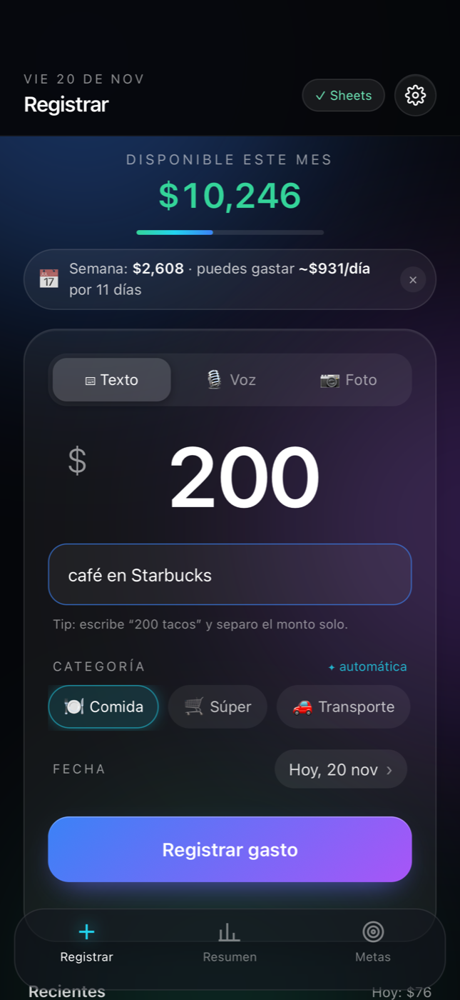
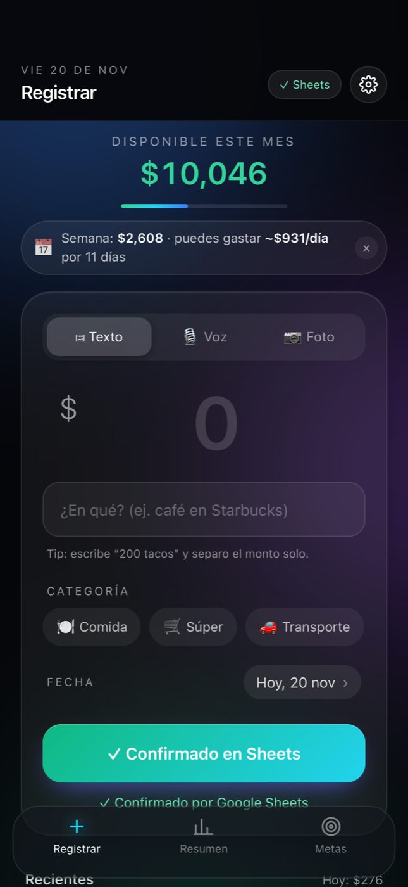
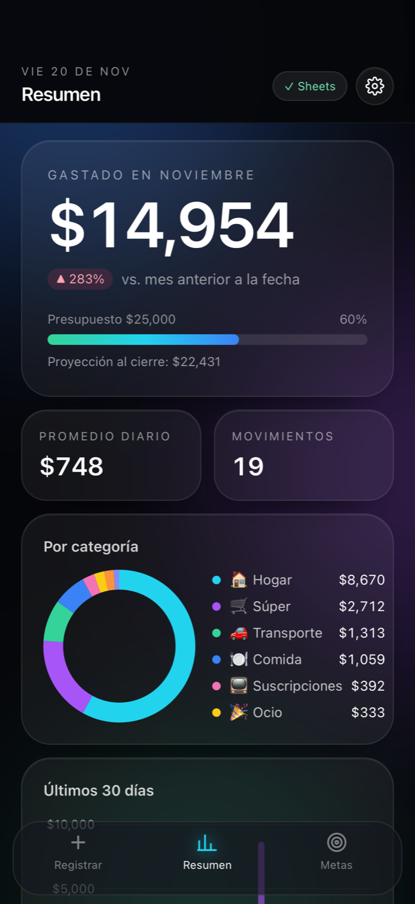
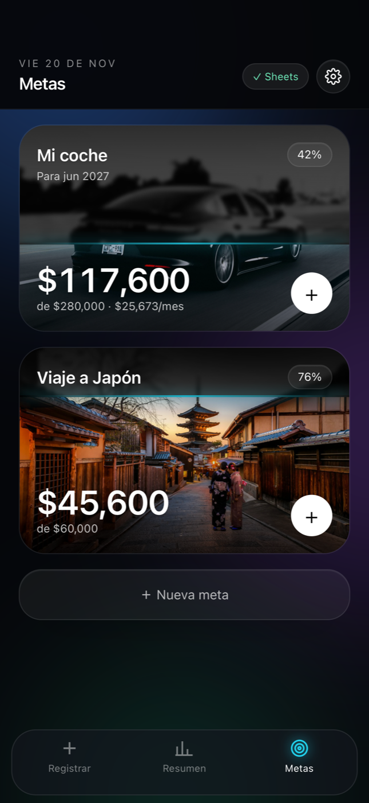
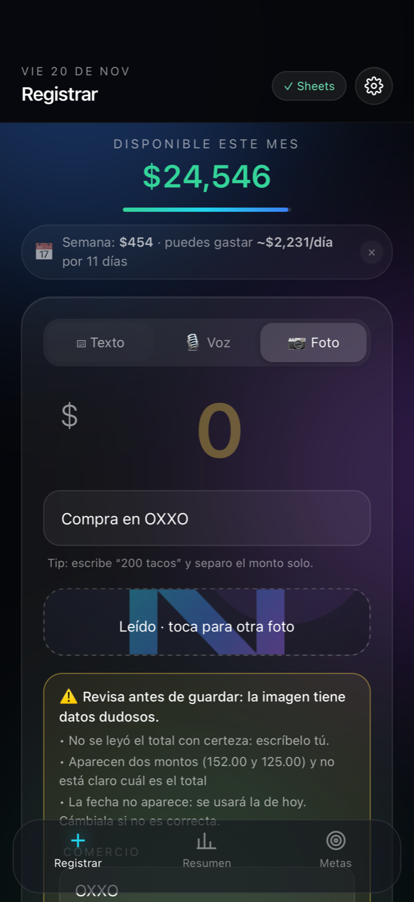
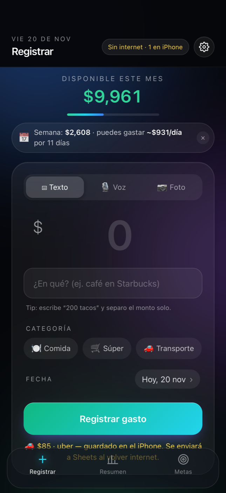

# NEST Finanzas

PWA de finanzas personales para iPhone: registro rápido (texto, voz, foto), dashboard, metas visuales y Google Sheets como base de datos.

**App publicada:** https://nestorbto-maker.github.io/nest-finanzas/

| Registro | Confirmado por Sheets | Resumen | Metas |
|---|---|---|---|
|  |  |  |  |

| Foto dudosa → revisión | Sin internet → guardado en el iPhone |
|---|---|
|  |  |

Capturas reales de la app a 393×852 pt (iPhone 15/16 Pro, @3x) en WebKit, con las áreas seguras del iPhone simuladas y datos de ejemplo.

---

## 1. Configurar Google Sheets (≈5 min)

1. Abre [sheets.new](https://sheets.new) y llama a la hoja **NEST Finanzas**.
2. **Extensiones → Apps Script**. Borra el contenido y pega todo [`backend/Code.gs`](backend/Code.gs). Guarda (⌘S).
3. Elige la función **`setup`** → **Ejecutar** → acepta los permisos.
   Se crean las hojas `Gastos`, `Categorias`, `Metas`, `Abonos`, `Config` y `Vision`. En **Registro de ejecución** aparece tu `APP_TOKEN`: cópialo.
4. *(Para leer fotos)* ⚙️ **Configuración del proyecto → Propiedades del script → Añadir**: `ANTHROPIC_API_KEY` = tu clave de [console.anthropic.com](https://console.anthropic.com).
5. **Implementar → Nueva implementación → ⚙️ Aplicación web** · Ejecutar como: **Yo** · Acceso: **Cualquier usuario** → **Implementar**. Copia la URL que termina en **`/exec`**.

> Si después cambias `Code.gs`: **Implementar → Gestionar implementaciones → ✏️ → Versión: Nueva versión**. La URL no cambia.

Categorías (emoji, palabras clave, presupuesto) y presupuesto mensual se editan directamente en las hojas `Categorias` y `Config`.

## 2. Instalar en el iPhone

1. Abre **https://nestorbto-maker.github.io/nest-finanzas/** en **Safari** → Compartir → **Añadir a pantalla de inicio**.
2. Abre **NEST** desde el ícono **con internet** (la primera apertura descarga la app para usarla offline).
3. Se abren los Ajustes: pega la URL `/exec`, el `APP_TOKEN` y tu presupuesto → **Guardar y conectar**. El indicador superior debe mostrar **✓ Sheets**.
4. En Ajustes, **Copiar enlace de configuración** te da un enlace que configura la app con un toque en otro navegador o dispositivo (contiene tu token: no lo compartas).

La app siempre abre en **Registrar**.

## 3. Botón de Acción

### Opción A — Abrir el formulario (recomendada)
App **Atajos** → ＋ → busca la acción **Abrir app** y comprueba si **NEST** aparece en la lista.
- **Si aparece:** elígela. Luego **Ajustes → Botón de Acción → Atajo →** ese atajo. Abre la app instalada en Registrar.
- **Si no aparece:** usa **Abrir URL** con `https://nestorbto-maker.github.io/nest-finanzas/#add`. iOS la abre en **Safari** (no en la app instalada), que tiene su propio almacenamiento: configúrala una vez allí con el *enlace de configuración* del paso 2.4. Los gastos de ambos lados llegan a la misma hoja.

> No pude verificar en un iPhone real cuál de las dos ocurre en tu versión de iOS. Dime cuál viste.

### Opción B — Dictar y guardar directo en Sheets, con revisión
1. **Dictar texto** · Idioma: Español (México).
2. **Copiar al portapapeles** → *Texto dictado* (para no perderlo si falla la conexión).
3. **Obtener contenido de URL** · URL: tu `/exec` · Método: **POST** · Cuerpo: **JSON**
   `token` (Texto) = tu APP_TOKEN · `action` (Texto) = `quickAdd` · `payload` (Diccionario) → `text` (Texto) = *Texto dictado*, `dryRun` (Booleano) = **Sí**
4. **Obtener valor del diccionario** → clave `status` de *Contenido de URL*.
5. **Si** *Valor del diccionario* **es** `preview`:
   1. **Obtener valor del diccionario** `review`, `editText` e `id` (tres acciones, de *Contenido de URL*).
   2. **Solicitar entrada** · Texto · Pregunta: `Se registrará: [review]. Corrige si hace falta` · Respuesta predeterminada: *editText*. (Cancelar = no se guarda nada).
   3. **Obtener contenido de URL** igual que el paso 3, pero `payload` → `text` = *Entrada proporcionada*, `id` (Texto) = *id* (sin `dryRun`).
   4. **Obtener valor del diccionario** `status` y `message`.
   5. **Si** `status` **es** `saved` → **Mostrar notificación** *message* (“✓ En Sheets: $200 · Café (Comida). Te quedan $X este mes.”). **De lo contrario** → **Mostrar alerta** *message*.
6. **De lo contrario** → **Mostrar alerta** con `message` (ej. “No encontré el monto…”).

El éxito solo aparece cuando Sheets respondió `saved`, y eso ocurre solo después de releer la hoja y encontrar la fila. Repetir la confirmación con el mismo `id` no duplica el gasto.

### Qué pasa si usas el Atajo sin conexión
- El paso 3 falla, Atajos muestra su propio error de conexión y se detiene. **No se guarda nada y no aparece ningún mensaje de éxito.**
- El Atajo **no tiene cola offline**: el gasto no se reintenta solo. El texto dictado queda en el portapapeles: abre NEST y pégalo en el concepto (“200 café” separa el monto solo). Así queda guardado en el iPhone y se envía a Sheets al volver internet.
- Caso límite: si la conexión se corta *justo después* de que Sheets guardó, Atajos mostrará error aunque el gasto sí exista. Revisa **Recientes** en la app antes de repetirlo.

## 4. Fotos de tickets: modelo y costo

La foto se reduce en el teléfono (lado mayor 1568 px). Apps Script la envía a **Claude Opus 5.5** (`claude-opus-5-5`) con esfuerzo bajo y una respuesta JSON con esquema fijo. La clave de la API nunca llega al teléfono.

**No inventar:** el esquema obliga al modelo a declarar `amount_legible`, `confidence` e `issues`. Si el total no es claro (dos montos, imagen cortada, no es un ticket), la app **deja el monto vacío**, muestra las dudas y no guarda hasta que tú escribas el monto. Fecha ausente → se avisa y se usa hoy. Todo (monto, concepto, comercio, categoría, fecha) es editable antes de guardar.

**Por qué Opus 5.5:** es el modelo más capaz para leer tickets de baja calidad y, sobre todo, para reconocer cuándo *no* está seguro. En finanzas, un monto equivocado que pasa desapercibido cuesta más que el modelo. Costo estimado (**cálculo, no medido**: imagen ≈1,500–2,500 tokens + ≈600 de instrucciones; salida ≈250–750 tokens):

| Modelo | Precio (USD por M tokens: entrada / salida) | Costo estimado por 100 tickets |
|---|---|---|
| **Opus 5.5** (actual) | $4 / $20 | **≈ $1.30 – $2.70** |
| Sonnet 5.5 | $2 / $10 | ≈ $0.65 – $1.35 |
| Haiku 5.5 | $0.10 / $0.50 | ≈ $0.03 – $0.07 |

**Precisión y tiempo de respuesta: no los he medido.** No tengo tu clave ni tickets reales, y no voy a dar cifras inventadas. La app los medirá con tus tickets:
- La hoja **`Vision`** registra por ticket: modelo, **segundos**, tokens y **costo real en USD**. La app también muestra “Leído en X s”.
- La columna **`Revisión`** de `Gastos` marca `foto: sin cambios` o `foto: corregido`. **Precisión real = % de tickets sin cambios.**

Tras ~30 tickets tendrás datos para decidir. Para probar otro modelo, añade la propiedad `CLAUDE_MODEL` (`claude-sonnet-5-5` o `claude-haiku-5-5`) sin tocar código y compara las mismas columnas.

## 5. Verificación

Las pruebas automáticas ejecutan la **PWA real** contra el **`backend/Code.gs` real**. `Code.gs` corre en Node con un Google Sheets simulado que imita el redirect de Apps Script y permite cortar conexiones. Resultado: **11/11 en WebKit y 11/11 en Chromium** ([WebKit](docs/resultados-webkit.md) · [Chromium](docs/resultados-chromium.md)).

### Probado automáticamente
- Abre en **Registrar** con Texto/Voz/Foto visibles y el botón Registrar por encima de la barra inferior, aun con el resumen semanal visible y las áreas seguras del iPhone simuladas.
- Gasto simple en 3 pasos (monto → concepto → Registrar). El botón y la línea de estado muestran **“En el iPhone · enviando…” → “✓ Confirmado en Sheets”**. Cada gasto en Recientes lleva la etiqueta *En el iPhone* o *✓ Sheets*.
- **Recorrido offline:** abrir → quitar internet → 2 gastos → cerrar → reabrir sin internet (los 2 siguen pendientes) → volver internet → **cada uno aparece exactamente 1 vez en Sheets**, también tras reabrir otra vez.
- **Respuesta perdida:** Sheets escribe pero la conexión se corta. La app muestra “1 sin enviar · reintentar” (nunca éxito), reintenta, y aunque el servidor recibió 3 envíos **hay 1 sola fila**.
- **Metas:** la imagen se revela 20% → 50% → 60%. El progreso se conserva al reabrir, y un abono con respuesta perdida no se suma dos veces.
- **Foto dudosa:** monto vacío, avisos visibles, guardar bloqueado hasta escribir el monto. **Foto clara:** campos rellenos y editables. Ambas con respuestas simuladas del modelo.
- **Voz:** con reconocimiento simulado, “doscientos cincuenta en tacos” → $250 · Tacos, editable antes de guardar.
- **Atajo (API):** la vista previa no escribe, confirmar escribe 1 vez, repetir no duplica, sin monto o con token inválido no guarda.
- Resumen semanal y cero errores de JavaScript en todo el recorrido.

### Pendiente de verificar en tu iPhone
- Instalación, arranque offline real y aspecto en iOS (las capturas son WebKit de escritorio, no Safari de iOS).
- Si **Abrir app** de Atajos lista NEST (Opción A).
- El Atajo de dictado (Opción B) en la app Atajos.
- Reconocimiento de voz de iOS dentro de la app instalada (`webkitSpeechRecognition`). Si falla, la app cambia a texto y sugiere el 🎙 del teclado.
- Lectura real de fotos con Claude: precisión, segundos y costo (se registran solos en la hoja `Vision`).

### Limitaciones comprobadas o conocidas
- **Playwright/WebKit no puede navegar en modo offline emulado**, aunque el service worker tenga la app. En WebKit la reapertura se probó con Sheets inaccesible; la reapertura 100% offline se probó en Chromium.
- **Vibración:** Safari en iOS no tiene API de vibración. Se intenta con el interruptor nativo de iOS 18+, como mejora no garantizada. La confirmación visual funciona siempre.
- **Atajo sin conexión:** no guarda ni reintenta; ver arriba.
- **Abrir URL** desde Atajos abre Safari, no la app instalada, y cada uno tiene su propio almacenamiento local.
- La primera apertura de la app instalada necesita internet para guardarse offline.
- Las fotos requieren internet (la app lo indica y puedes registrar por texto).

## Desarrollo

```bash
npm install          # Tailwind, Chart.js y Playwright (solo desarrollo)
npm run build        # compila css/tailwind.css y copia Chart.js a vendor/
npm test             # pruebas E2E en WebKit (node tests/e2e.mjs chromium para Chromium)
node tests/mock-gas.mjs 8787 --seed   # app + Sheets simulado en http://localhost:8787/index.html (token: test-token)
```

La app no tiene paso de compilación en producción: HTML + CSS + JS servidos tal cual. Al publicar cambios, sube `VERSION` en `sw.js` para que el iPhone descargue la versión nueva.
